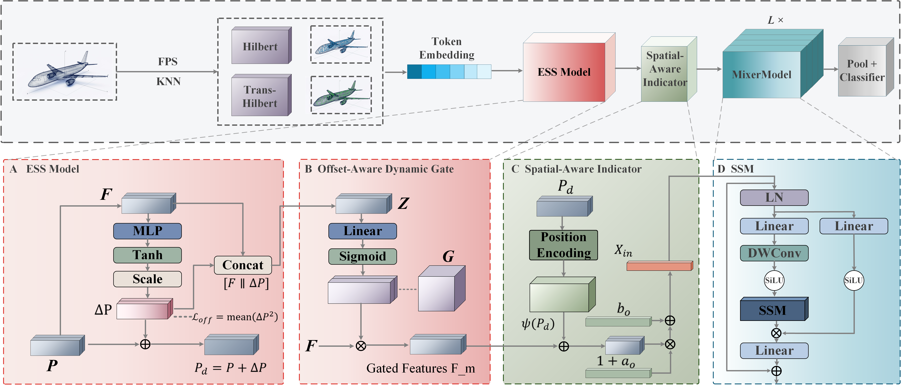

<div align="center">
<h1>ElaMamba</h1>
<h3>Empowering State Space Models with Elastic Structural Scanning for 3D Point Clouds</h3>

[Zhiqiang Li]()<sup>1</sup>\*, [Qi Liu]()<sup>1</sup>\*, [Yufei Li]()<sup>2</sup>, [Qiang Feng]()<sup>3</sup>, [Shiyang Li]()<sup>1</sup>, [Xiyue Wang]()<sup>1</sup>, [Yining Sun]()<sup>1</sup>, [Xin Liu]()<sup>1</sup>, [Mengfan Ma]()<sup>1</sup>, [Yinghao Sun]()<sup>1</sup>, [Lei Yang]()<sup>1</sup>, [Xiaohong Yu]()<sup>1</sup>, [Chenfei Shi]()<sup>1</sup>, [Yixuan Ding]()<sup>1</sup>, and [Lin Da]()<sup>1†</sup>

<sup>1</sup> School of Mathematical Sciences, Inner Mongolia University, Hohhot, China <br>
<sup>2</sup> School of Computer Science and Communication Engineering, Northeastern University, Qinhuangdao, China <br>
<sup>3</sup> School of Electronic and Information Engineering, Inner Mongolia University, Hohhot, China

(\*) Equal contribution. (†) Corresponding author.


[](https://opensource.org/licenses/Apache-2.0)

</div>

## 📣 News

- **[May 2026]** 🚀 We release the official implementation of **ElaMamba**, including the complete Elastic Structural Scanning (ESS) module and pre-trained weights!


## 📝 Abstract

ElaMamba studies geometry-conditioned representation for point-cloud classification with a selective state-space backbone. Following FPS/KNN tokenization, the model retains Hilbert and Hilbert-trans token orderings. Elastic Structural Scanning (ESS) predicts bounded feature-conditioned coordinate offsets, which condition positional embeddings and a channel-wise gating layer without reordering tokens or resampling local point features. Branch-wise affine transformations and a spatial indicator further modulate the representation before Mamba processing. Training includes a fixed-weight mean-squared offset penalty. ElaMamba achieves **93.0%** overall accuracy on ModelNet40 and **88.34%** on ScanObjectNN PB-T50-RS without voting. These results support competitive classification performance. Our code is available in this repository.

## 🌟 Key Contributions

* **Geometry-conditioned fixed serialization:** ESS predicts bounded, feature-conditioned coordinate offsets after Hilbert and Hilbert-trans serialization while retaining the fixed token indices. The offsets do not trigger a second sorting operation, point resampling, or neighborhood reconstruction.
* **Offset-conditioned representation modulation:** Displaced positional anchors, an Offset-Aware Dynamic Gate, branch-specific affine transformations, and a Spatial-Aware Indicator jointly modulate the token representation supplied to the Mamba backbone.
* **Explicit offset regularization:** A fixed-weight mean-squared offset penalty constrains the magnitude of the learned coordinate adjustments during training.
* **Point-cloud classification results:** ElaMamba obtains 93.0% OA on ModelNet40 and 88.34% OA on ScanObjectNN PB-T50-RS without voting under the reported evaluation protocols.

## 🏛️ Architecture Overview

<div align="center">
  
</div>

<p align="justify">
  <b>Figure 1: Overall architecture of ElaMamba.</b> FPS and KNN tokenization generate group-center coordinates and geometric token features, followed by two fixed-index streams constructed with Hilbert and Hilbert-trans serialization. <b>(A) Elastic Structural Scanning (ESS)</b> predicts bounded, feature-conditioned coordinate offsets and constructs displaced positional anchors without point resampling, neighborhood reconstruction, or changes to the discrete serialization order. <b>(B) The Offset-Aware Dynamic Gate</b> produces channel-wise gating coefficients from the token features and complete offset vectors. <b>(C) The Spatial-Aware Indicator</b> combines gated features with displaced-anchor embeddings to generate input-dependent affine modulation terms. <b>(D) Standard Mamba blocks</b> aggregate sequence context before stream-wise pooling and classification. A fixed-weight mean-squared offset penalty constrains the learned coordinate adjustments during training.
</p>

## 📊 Main Results

| Task | Dataset | Input points | Evaluation | Config | Overall Acc. | Download |
| :---- | :---- | :----: | :----: | :---- | :----: | :----: |
| Pre-training | ShapeNet | — | — | [pretrain.yaml](./cfgs/pretrain.yaml) | N.A. | [ckpt](https://github.com/lzq3367785771/Elamamba/releases/download/v1.0/pretrain.pth) |
| Classification | ModelNet40 | 1,024 | Without voting | [finetune_modelnet.yaml](./cfgs/finetune_modelnet.yaml) | **93.0%** | [ckpt](https://github.com/lzq3367785771/Elamamba/releases/download/v1.0/modelnet_best.pth) |
| Classification | ScanObjectNN PB-T50-RS | 2,048 | Without voting | [finetune_scan_hardest.yaml](./cfgs/finetune_scan_hardest.yaml) | **88.34%** | [ckpt](https://github.com/lzq3367785771/Elamamba/releases/download/v1.0/scanobjectnn_best.pth) |


## 🛠️ Getting Started

### 1. Environment Setup

We recommend using Conda to manage your environment. You can also refer to the detailed [`docs/environment.yml`](./docs/environment.yml).
```bash
conda create -n elamamba python=3.9.18 -y
conda activate elamamba
conda install pytorch torchvision torchaudio pytorch-cuda=11.7 -c pytorch -c nvidia

# Install dependencies
pip install -r requirements.txt

# Compile PointNet2 operations
cd extensions/pointnet2_ops_lib
python setup.py install
cd ../../
```

### 2. Data Preparation

Please organize your datasets in the `data/` directory as follows:

- **ModelNet40:** `data/ModelNet/modelnet40_normal_resampled`
- **ScanObjectNN:** `data/ScanObjectNN`

**👉 See [`docs/DATASET.md`](./docs/DATASET.md) for detailed dataset instructions.**

### 3. Usage


**👉 See [`docs/USAGE.md`](./docs/USAGE.md) for full commands on training, fine-tuning, and evaluation.**


## 🤝 Acknowledgement

Our codebase is built upon several excellent open-source projects. We express our gratitude to the authors of:

* [PointMamba](https://github.com/LMD0311/PointMamba)
* [Point-MAE](https://github.com/Pang-Yatian/Point-MAE)
* [Mamba](https://github.com/state-spaces/mamba)

## 📖 Citation

If you find our method or code useful in your research, please consider giving us a star ⭐ and citing our paper:

```bibtex
@article{ElaMamba2026,
  title={ElaMamba: Empowering State Space Models with Elastic Structural Scanning for 3D Point Clouds},
  author={Li, Zhiqiang and Liu, Qi and Li, Yufei and Feng, Qiang and Li, Shiyang and Wang, Xiyue and others},
  journal={Under review},
  year={2026}
}
```
